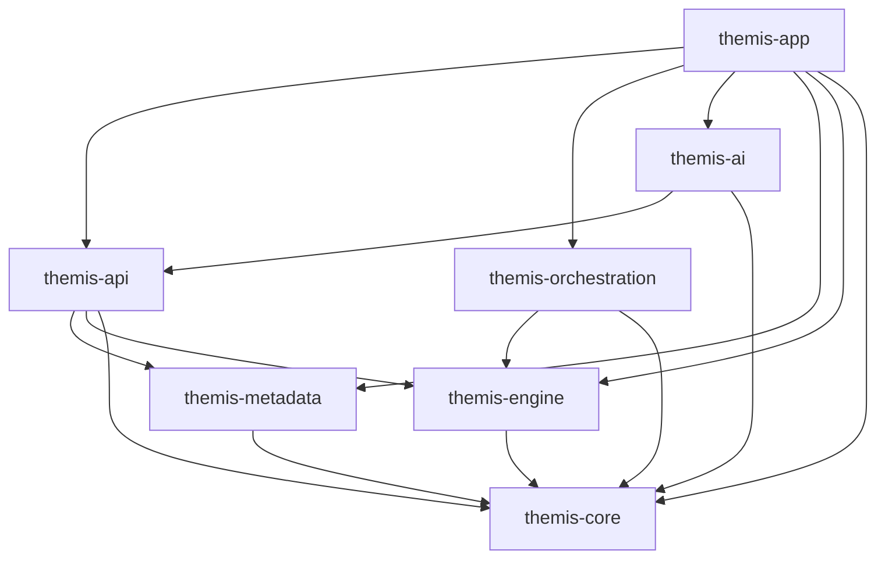
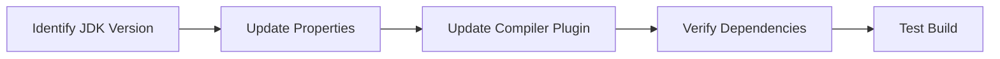
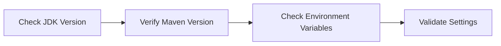
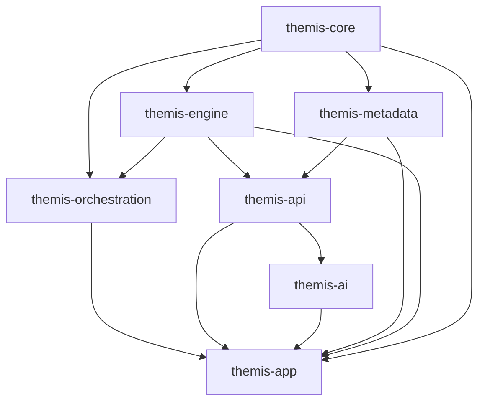

# Maven Build Error Resolution for Themis Rule Engine

## Overview

This document outlines the systematic approach to resolve Maven compilation errors in the Themis Rule Engine project. The Themis project is a multi-module Maven project built with Java and Spring Boot, containing seven modules: themis-core, themis-engine, themis-metadata, themis-api, themis-orchestration, themis-ai, and themis-app.

## Architecture Analysis

### Project Structure



### Module Dependencies Matrix

| Module | Dependencies |
|--------|-------------|
| themis-app | All other modules |
| themis-api | core, engine, metadata |
| themis-orchestration | core, engine |
| themis-ai | core, api |
| themis-metadata | core |
| themis-engine | core |
| themis-core | (base module) |

## Build Error Categories

### 1. Java Version Compatibility Issues

**Problem**: Conflicting Java version configurations
- Properties section: Java 11 (`maven.compiler.source>11`, `maven.compiler.target>11`)
- Maven compiler plugin: Java 8 (`<source>8</source>`, `<target>8</target>`)

**Impact**: Compilation fails due to inconsistent compiler settings

**Resolution Strategy**:


### 2. Missing Classes and Interface Implementations

**Problem**: References to undefined classes in themis-orchestration module
- `WorkflowStep` class incomplete implementation
- Missing method implementations in interfaces

**Impact**: Compilation errors due to undefined symbols

### 3. Dependency Version Conflicts

**Problem**: Potential dependency version mismatches
- Spring Boot 2.7.18 with various third-party libraries
- Drools 8.44.0.Final compatibility issues

## Build Resolution Process

### Phase 1: Environment Verification


### Phase 2: Configuration Standardization

#### Java Version Alignment
**Target Configuration**:
- Standardize on Java 11 across all modules
- Update maven-compiler-plugin configuration
- Ensure consistency in properties and plugin sections

#### Dependency Management
**Approach**:
- Leverage Spring Boot BOM for version management
- Use dependencyManagement section for version control
- Resolve transitive dependency conflicts

### Phase 3: Missing Implementation Resolution

#### Workflow Step Implementation
**Required Components**:
- Complete `WorkflowStep` class implementation
- Add missing enum types and inner classes
- Implement required interface methods

#### Validation Classes
**Missing Elements**:
- `ValidationResult.ValidationError` class
- `ValidationResult.ValidationWarning` class
- Proper inheritance hierarchy

### Phase 4: Module Build Order



## Implementation Steps

### Step 1: Fix Java Version Consistency
1. Update maven-compiler-plugin configuration to Java 11
2. Verify all modules inherit correct Java version
3. Update any hardcoded Java 8 references

### Step 2: Resolve Missing Classes
1. Implement missing `WorkflowStep` components:
   - `StepType` enum
   - `StepCondition` class
   - Required getters/setters
2. Add missing validation classes to themis-core module
3. Complete interface implementations

### Step 3: Dependency Conflict Resolution
1. Review transitive dependencies using `mvn dependency:tree`
2. Add explicit exclusions for conflicting artifacts
3. Standardize versions through parent POM

### Step 4: Incremental Build Testing
1. Build themis-core module first
2. Progressive module compilation
3. Integration testing with full build

## Error Prevention Strategies

### Build Configuration
- Use consistent Java version across all modules
- Leverage Maven's dependencyManagement
- Implement proper module isolation

### Code Quality
- Complete interface implementations before dependencies
- Use proper package structure
- Maintain circular dependency prevention

### Testing Strategy
- Unit tests for each module
- Integration tests for cross-module functionality
- Build verification tests

## Build Commands Reference

### Standard Build Process
```bash
# Clean and compile all modules
mvn clean compile

# Full build with tests
mvn clean install

# Skip tests for faster build
mvn clean install -DskipTests

# Dependency analysis
mvn dependency:tree
mvn dependency:analyze
```

### Module-Specific Build
```bash
# Build specific module
mvn clean install -pl thomis-core

# Build with dependencies
mvn clean install -pl themis-app -am
```

### Error Diagnosis
```bash
# Detailed error reporting
mvn clean compile -X

# Show dependency conflicts
mvn dependency:tree -Dverbose

# Validate project structure
mvn validate
```

## Success Criteria

### Build Completion Metrics
- All modules compile without errors
- No missing class references
- Consistent Java version usage
- Clean dependency resolution

### Quality Gates
- Zero compilation errors across all modules
- No circular dependencies
- Proper Maven module isolation
- Spring Boot application starts successfully

## Risk Mitigation

### Backup Strategy
- Version control checkpoint before changes
- Incremental changes with commit points
- Rollback procedures for failed changes

### Validation Process
- Module-by-module build verification
- Integration testing after fixes
- Application startup validation