# Themis 新一代规则引擎架构设计

## 1. 概述

### 1.1 设计目标

基于美团Zeus、蚂蚁AlphaRisk等一线互联网公司规则引擎的设计思路，重新设计Themis规则引擎，使其成为企业级、高性能、可扩展的智能决策平台。

**核心设计原则**：
- **高抽象化**：规则定义与引擎实现解耦，支持多种规则描述方式
- **高性能**：多引擎策略，针对不同场景选择最优执行引擎
- **高扩展性**：插件化架构，支持自定义函数、因子、决策逻辑
- **易用性**：提供多种规则调度方式，满足不同业务场景

### 1.2 系统定位

Themis定位为**通用规则决策引擎平台**，适用于：
- 风控场景：反欺诈、反作弊、反洗钱
- 营销场景：精准投放、权益发放、活动准入
- 业务决策：信贷审批、保险核保、订单路由
- 内容治理：内容审核、违规识别、质量评分

### 1.3 技术栈

| 类别 | 技术选型 |
|------|---------|
| 规则表达式 | Aviator、MVEL、Groovy、SpEL |
| 高性能引擎 | Drools (RETE)、自研内存计算引擎 |
| 插件框架 | Java SPI、Spring Plugin |
| 脚本引擎 | GraalVM JS、Groovy Script |
| 存储层 | Redis、MySQL、Etcd |
| 流程编排 | BPMN 2.0、自研DAG引擎 |

## 2. 核心架构

### 2.1 分层架构

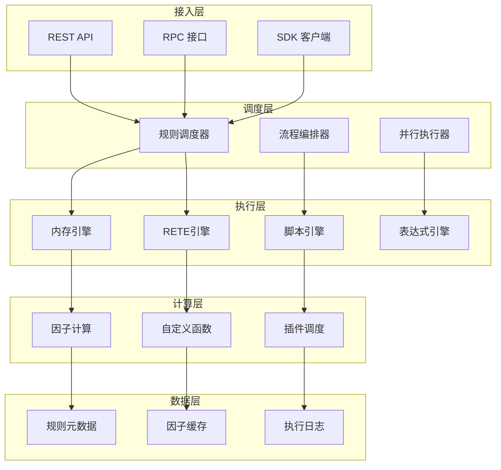

### 2.2 模块职责

| 模块 | 职责 |
|------|------|
| 接入层 | 提供多种接入方式，统一请求路由与参数校验 |
| 调度层 | 规则编排、执行模式选择、并行调度 |
| 执行层 | 规则解析、条件评估、动作执行 |
| 计算层 | 因子计算、函数执行、插件调用 |
| 数据层 | 规则存储、缓存管理、日志持久化 |

## 3. 规则定义抽象化设计

### 3.1 规则定义协议（RDP - Rule Definition Protocol）

**设计思路**：将规则定义抽象为统一的协议接口，支持多种描述语言，实现规则定义与存储格式解耦。

#### 3.1.1 规则定义抽象层次

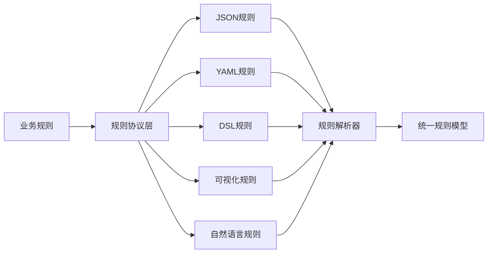

#### 3.1.2 规则定义核心接口

**RuleDefinitionProtocol** - 规则定义协议接口

| 方法 | 说明 |
|------|------|
| parse | 将外部格式解析为内部规则模型 |
| validate | 验证规则定义的合法性 |
| serialize | 将规则模型序列化为外部格式 |
| getFormat | 获取支持的格式类型 |

**支持的规则格式**：

| 格式类型 | 描述 | 适用场景 |
|---------|------|---------|
| JSON | 结构化JSON格式 | API调用、配置存储 |
| YAML | 可读性强的YAML | 配置文件、人工编辑 |
| DSL | 领域特定语言 | 策略专家编写 |
| Visual | 可视化拖拽配置 | 运营人员操作 |
| NLP | 自然语言描述 | AI辅助生成 |
| Excel | 决策表格式 | 业务人员配置 |
| Groovy | 动态脚本 | 复杂逻辑实现 |

### 3.2 规则模型抽象

#### 3.2.1 统一规则元模型

**RuleMetaModel** - 规则元模型结构

| 元素 | 类型 | 说明 |
|------|------|------|
| ruleId | String | 规则唯一标识 |
| ruleName | String | 规则名称 |
| ruleType | RuleTypeEnum | 规则类型 |
| condition | Condition | 条件表达式 |
| action | Action | 执行动作 |
| priority | Integer | 优先级 |
| version | String | 版本号 |
| lifecycle | Lifecycle | 生命周期状态 |
| metadata | Map | 扩展元数据 |

#### 3.2.2 规则类型扩展机制

**规则类型注册表**：

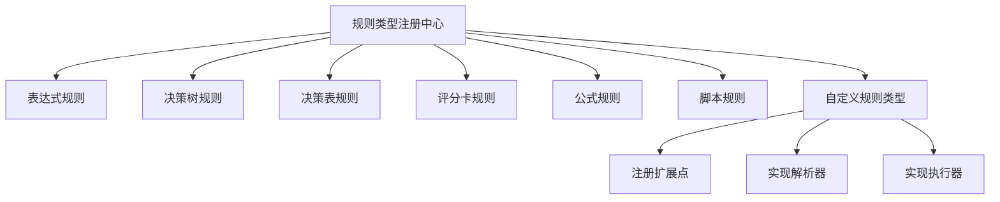

**扩展方式**：通过SPI机制注册自定义规则类型

| 扩展点 | 接口 | 说明 |
|--------|------|------|
| 规则解析器 | RuleParser | 解析特定格式的规则定义 |
| 规则执行器 | RuleExecutor | 执行特定类型的规则 |
| 规则验证器 | RuleValidator | 验证规则的合法性 |

### 3.3 规则定义示例

#### 3.3.1 JSON格式定义

**场景**：用户登录风险识别

```
规则名称：高风险登录检测
规则条件：
  - 登录失败次数（5分钟内）> 3次
  - 登录IP所在城市 != 用户常住城市
  - 设备指纹为陌生设备
规则动作：
  - 触发短信验证
  - 记录风险事件
  - 风险等级 = HIGH
```

**描述要素**：
- 条件字段：login_fail_count_5m, login_city, device_fingerprint
- 条件逻辑：AND组合
- 动作列表：trigger_sms, log_risk_event, set_risk_level

#### 3.3.2 DSL格式定义

**规则表达**：
```
规则定义:
  WHEN 近5分钟登录失败次数 > 3 
   AND 登录城市 不等于 常住城市
   AND 设备为陌生设备
  THEN 要求短信验证
   AND 标记风险等级为HIGH
```

#### 3.3.3 自然语言定义

**规则描述**：
```
如果用户在5分钟内登录失败超过3次，
并且登录城市与常住城市不一致，
并且使用的是陌生设备，
那么要求进行短信验证，并将风险等级标记为高风险。
```

**转换流程**：自然语言 → NLP解析 → 规则AST → 规则模型

## 4. 规则输入参数模型设计

### 4.1 参数分类体系

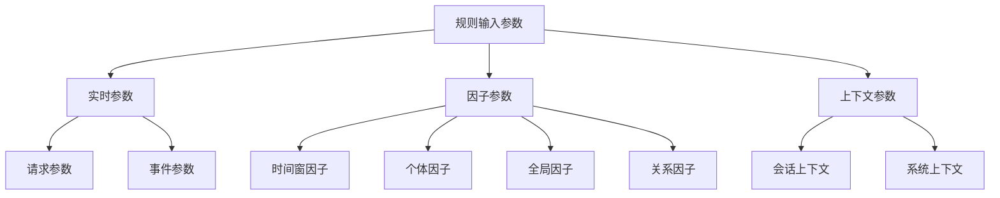

### 4.2 参数类型定义

#### 4.2.1 实时参数

**定义**：规则执行时直接传入的业务参数

| 参数类型 | 说明 | 示例 |
|---------|------|------|
| 请求参数 | 来自业务请求的原始数据 | userId, orderId, amount |
| 事件参数 | 业务事件相关信息 | eventType, eventTime, eventSource |
| 业务对象 | 完整的业务实体对象 | Order, User, Product |

#### 4.2.2 因子参数

**定义**：需要经过计算或查询获得的衍生特征

**时间窗因子**

| 因子维度 | 说明 | 计算逻辑 | 示例 |
|---------|------|---------|------|
| 计数因子 | 统计时间窗内事件次数 | COUNT(event) WHERE time IN window | 用户5分钟内登录次数 |
| 求和因子 | 时间窗内数值累加 | SUM(value) WHERE time IN window | 用户今日消费金额 |
| 均值因子 | 时间窗内平均值 | AVG(value) WHERE time IN window | 用户近7日平均订单金额 |
| 最值因子 | 时间窗内最大/最小值 | MAX/MIN(value) WHERE time IN window | 用户近30日最大单笔交易 |
| 去重因子 | 时间窗内去重计数 | COUNT(DISTINCT field) WHERE time IN window | 用户近1小时使用设备数 |
| 趋势因子 | 时间窗内变化趋势 | TREND(value) WHERE time IN window | 用户交易金额增长率 |

**时间窗类型**：

| 窗口类型 | 说明 | 配置示例 |
|---------|------|---------|
| 滑动窗口 | 从当前时间向前推的固定时长 | 最近5分钟、最近1小时 |
| 滚动窗口 | 固定时间边界的窗口 | 今日、本周、本月 |
| 会话窗口 | 基于事件间隔的动态窗口 | 用户活跃会话期 |

**个体因子**

| 因子类型 | 说明 | 数据来源 | 示例 |
|---------|------|---------|------|
| 用户画像 | 用户的静态属性特征 | 用户中心 | 年龄、性别、职业、会员等级 |
| 设备画像 | 设备相关特征 | 设备库 | 设备型号、操作系统、设备信誉 |
| 商户画像 | 商户的属性特征 | 商户中心 | 商户类型、经营年限、信用评分 |
| 历史行为 | 个体的历史行为统计 | 行为数据库 | 历史订单数、平均客单价 |

**全局因子**

| 因子类型 | 说明 | 计算范围 | 示例 |
|---------|------|---------|------|
| 平台统计 | 全平台维度的统计指标 | 全局 | 平台日均订单量、活跃用户数 |
| 业务指标 | 特定业务线的指标 | 业务域 | 某品类的销售趋势 |
| 环境因子 | 外部环境相关因子 | 外部系统 | 节假日标识、天气状况 |

**关系因子**

| 因子类型 | 说明 | 图谱类型 | 示例 |
|---------|------|---------|------|
| 社交关系 | 用户间的关联关系 | 社交图谱 | 共同好友数、亲密度 |
| 设备关联 | 设备间的关联关系 | 设备图谱 | 同IP设备数、设备聚集度 |
| 交易关联 | 交易主体间的关联 | 交易图谱 | 资金流转路径、交易闭环 |

### 4.3 因子计算框架

#### 4.3.1 因子计算流程

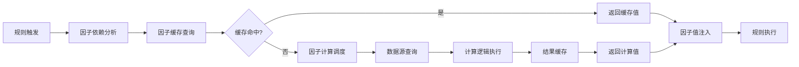

#### 4.3.2 因子定义模型

**FactorDefinition** - 因子定义

| 属性 | 类型 | 说明 |
|------|------|------|
| factorId | String | 因子唯一标识 |
| factorName | String | 因子名称 |
| factorType | FactorTypeEnum | 因子类型 |
| dataSource | DataSourceConfig | 数据源配置 |
| computeLogic | ComputeExpression | 计算逻辑 |
| cacheStrategy | CacheStrategy | 缓存策略 |
| timeWindow | TimeWindowConfig | 时间窗配置（可选） |
| dependencies | List&lt;String&gt; | 依赖的其他因子 |

#### 4.3.3 因子计算引擎

**计算模式**：

| 模式 | 说明 | 适用场景 |
|------|------|---------|
| 实时计算 | 规则执行时同步计算 | 低频访问、时效性要求高 |
| 预计算 | 定时批量计算并缓存 | 高频访问、计算复杂 |
| 流式计算 | 基于事件流实时更新 | 时间窗因子、实时统计 |
| 混合模式 | 预计算+增量更新 | 兼顾性能和实时性 |

**缓存策略**：

| 策略 | TTL | 更新机制 | 适用因子类型 |
|------|-----|---------|------------|
| 短时缓存 | 1-5分钟 | 被动过期 | 时间窗因子 |
| 中时缓存 | 1-24小时 | 定时刷新 | 个体画像 |
| 长时缓存 | 1-7天 | 事件触发更新 | 全局统计 |
| 无缓存 | - | 实时计算 | 强实时因子 |

### 4.4 参数上下文设计

#### 4.4.1 上下文分层

**RuleContext** - 规则执行上下文

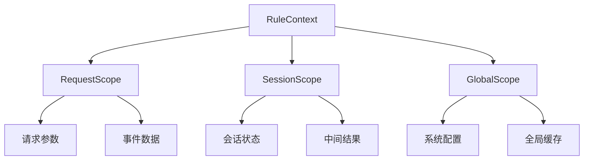

#### 4.4.2 参数访问模式

**参数访问优先级**：

1. 请求作用域（RequestScope）：当前请求的实时参数
2. 会话作用域（SessionScope）：当前执行会话的中间状态
3. 因子作用域（FactorScope）：计算得到的因子值
4. 全局作用域（GlobalScope）：全局配置和缓存数据

**参数注入方式**：

| 注入方式 | 说明 | 示例 |
|---------|------|------|
| 直接注入 | 请求参数直接传入 | context.set("userId", "123") |
| 延迟加载 | 首次访问时加载 | context.getLazy("userProfile") |
| 动态计算 | 访问时实时计算 | context.compute("risk_score") |

## 5. 规则执行引擎设计

### 5.1 多引擎策略

**设计思路**：针对不同场景选择最优执行引擎，实现性能与灵活性的平衡

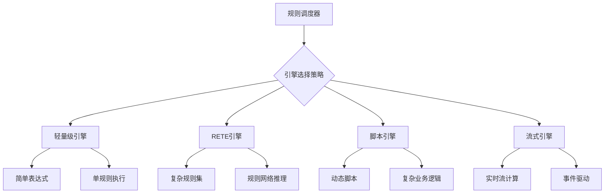

### 5.2 引擎类型对比

| 引擎类型 | 执行方式 | 性能特点 | 适用场景 | 规则规模 |
|---------|---------|---------|---------|---------|
| 轻量级引擎 | 顺序执行 | 低延迟（&lt;1ms） | 简单条件判断 | &lt;50条规则 |
| RETE引擎 | 模式匹配 | 中延迟（5-20ms） | 复杂规则网络 | 50-10000条 |
| 脚本引擎 | 动态编译 | 中延迟（10-50ms） | 复杂业务逻辑 | 不限 |
| 流式引擎 | 事件驱动 | 高吞吐（万/秒） | 实时流计算 | 不限 |

### 5.3 引擎实现方案

#### 5.3.1 轻量级内存引擎

**设计特点**：
- 基于表达式引擎（Aviator/MVEL）
- 顺序执行或优先级队列
- 支持短路评估
- 最小化对象创建

**执行流程**：

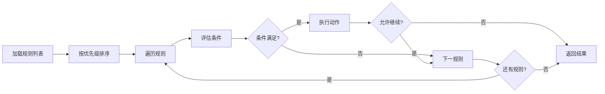

**性能优化**：

| 优化技术 | 说明 | 效果 |
|---------|------|------|
| 表达式预编译 | 规则加载时编译表达式 | 减少50%执行时间 |
| 短路评估 | AND条件遇False立即返回 | 减少30%计算量 |
| 条件重排序 | 选择性高的条件前置 | 提升20%效率 |
| 对象池化 | 复用Context对象 | 减少GC压力 |

#### 5.3.2 RETE引擎

**基于Drools封装**：

**RETE算法核心**：
- Alpha节点：单条件过滤
- Beta节点：多条件连接
- 工作内存：事实对象存储
- 规则网络：编译期优化

**封装增强**：

| 增强功能 | 说明 |
|---------|------|
| 规则热更新 | 支持规则动态加载和卸载 |
| 分片执行 | 大规则集分片并行执行 |
| 优先级控制 | 扩展Drools的salience机制 |
| 因子集成 | 无缝集成因子计算框架 |
| 性能监控 | 规则级性能统计 |

**适用场景判断**：

```
选择RETE引擎的条件：
  - 规则数量 > 100
  - 存在规则间依赖关系
  - 需要模式匹配推理
  - 事实对象频繁更新
```

#### 5.3.3 脚本引擎

**支持的脚本语言**：

| 脚本类型 | 引擎实现 | 特点 | 使用场景 |
|---------|---------|------|---------|
| Groovy | GroovyScriptEngine | 完全Java兼容 | 复杂业务逻辑 |
| JavaScript | GraalVM JS | 高性能JIT | 动态规则配置 |
| Python | Jython | 丰富的库支持 | 数据分析场景 |

**脚本沙箱机制**：

| 安全控制 | 实现方式 |
|---------|---------|
| 类白名单 | 限制可访问的Java类 |
| 执行超时 | 设置脚本最大执行时间 |
| 资源限制 | 限制内存和CPU使用 |
| 权限隔离 | 基于SecurityManager |

**脚本执行流程**：


#### 5.3.4 流式引擎

**基于事件流的规则处理**：

**技术选型**：
- Flink CEP（复杂事件处理）
- 自研流式规则引擎

**执行模型**：


**适用场景**：
- 实时风控：高频交易监控
- 实时营销：用户行为触发
- 异常检测：系统监控告警

### 5.4 引擎选择策略

#### 5.4.1 自动选择机制

**选择决策表**：

| 条件 | 引擎选择 |
|------|---------|
| 规则数 &lt; 10 AND 无脚本 | 轻量级引擎 |
| 规则数 10-100 AND 规则独立 | 轻量级引擎 |
| 规则数 &gt; 100 OR 规则有依赖 | RETE引擎 |
| 包含脚本逻辑 | 脚本引擎 |
| 事件流处理 | 流式引擎 |

#### 5.4.2 手动指定模式

**场景配置**：

```
场景定义：用户登录风控
执行引擎：RETE
引擎配置：
  - 工作内存模式：IDENTITY
  - 规则激活策略：PRIORITY
  - 并发模式：PARTITION
```

### 5.5 执行性能优化

#### 5.5.1 性能优化技术

| 优化维度 | 技术手段 | 性能提升 |
|---------|---------|---------|
| 编译优化 | 规则预编译、表达式缓存 | 50% |
| 执行优化 | 短路评估、条件重排 | 30% |
| 并行优化 | 规则并行执行 | 200%+ |
| 缓存优化 | 因子缓存、结果缓存 | 80% |
| 内存优化 | 对象池化、零拷贝 | 减少GC 60% |

#### 5.5.2 Benchmark设计

**性能测试维度**：

| 测试指标 | 测试方法 | 目标值 |
|---------|---------|--------|
| 单规则执行延迟 | JMH微基准测试 | P99 &lt; 1ms |
| 批量规则吞吐 | 并发压测 | QPS &gt; 10000 |
| 内存占用 | 堆内存监控 | &lt; 512MB(1000规则) |
| GC频率 | GC日志分析 | &lt; 10次/分钟 |

**Benchmark测试场景**：

| 场景 | 规则数 | 因子数 | 并发数 | 测试目标 |
|------|-------|-------|-------|---------|
| 简单表达式 | 10 | 5 | 100 | 轻量级引擎基准 |
| 复杂规则集 | 500 | 50 | 100 | RETE引擎基准 |
| 脚本执行 | 10 | 10 | 50 | 脚本引擎基准 |
| 混合场景 | 100 | 30 | 200 | 真实业务模拟 |

**性能对比分析**：

```
对比维度：
  - 不同引擎的执行性能
  - 不同规则复杂度的性能曲线
  - 不同因子数量的影响
  - 不同并发下的吞吐量
  - 不同优化策略的效果
```

## 6. 插件化体系设计

### 6.1 插件架构

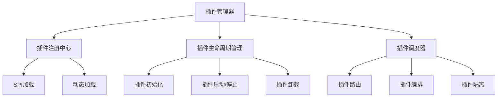

### 6.2 插件类型定义

| 插件类型 | 职责 | 扩展点 |
|---------|------|--------|
| 数据源插件 | 接入外部数据源 | DataSourcePlugin |
| 计算插件 | 自定义计算逻辑 | ComputePlugin |
| 动作插件 | 自定义规则动作 | ActionPlugin |
| 函数插件 | 自定义函数库 | FunctionPlugin |
| 通知插件 | 消息通知集成 | NotificationPlugin |
| 存储插件 | 自定义存储实现 | StoragePlugin |

### 6.3 插件标准接口

**ThemisPlugin** - 插件基础接口

| 方法 | 说明 |
|------|------|
| getPluginId | 获取插件唯一标识 |
| getPluginName | 获取插件名称 |
| getVersion | 获取插件版本 |
| init | 插件初始化 |
| start | 插件启动 |
| stop | 插件停止 |
| destroy | 插件销毁 |
| getConfig | 获取插件配置 |

### 6.4 插件调度机制

#### 6.4.1 插件调用方式

| 调用模式 | 说明 | 使用场景 |
|---------|------|---------|
| 同步调用 | 阻塞等待插件返回 | 关键路径的计算 |
| 异步调用 | 非阻塞执行 | 日志记录、通知发送 |
| 回调调用 | 插件执行完成后回调 | 异步处理结果获取 |
| 流式调用 | 支持数据流传输 | 大数据量处理 |

#### 6.4.2 插件编排

**编排方式**：

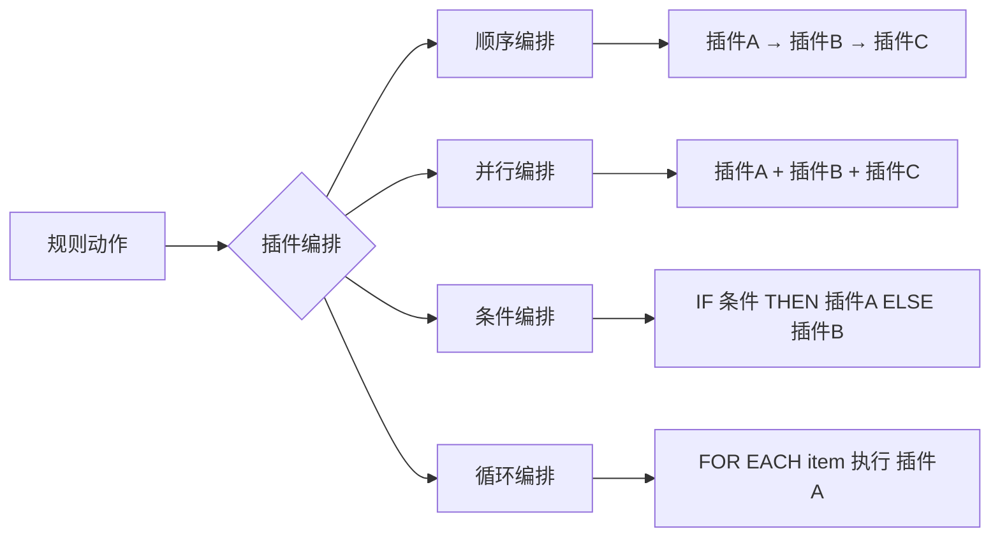

### 6.5 插件隔离与安全

#### 6.5.1 隔离机制

| 隔离层面 | 实现方式 |
|---------|---------|
| 类加载隔离 | 自定义ClassLoader |
| 线程隔离 | 独立线程池 |
| 资源隔离 | 资源配额限制 |
| 异常隔离 | 异常捕获和降级 |

#### 6.5.2 插件监控

**监控指标**：

| 指标 | 说明 |
|------|------|
| 调用次数 | 插件被调用的总次数 |
| 执行耗时 | P50/P99耗时统计 |
| 成功率 | 执行成功的比例 |
| 异常率 | 抛出异常的比例 |
| 资源占用 | CPU、内存占用 |

### 6.6 插件开发指南

**插件开发流程**：

1. 实现插件接口
2. 编写插件配置
3. 插件打包
4. 插件注册
5. 插件测试
6. 插件发布

**插件配置示例**：

```
插件定义：
  插件ID: risk-score-calculator
  插件名称: 风险评分计算器
  插件类型: ComputePlugin
  版本: 1.0.0
  
配置参数：
  - 权重模型: weight_model_v1
  - 评分阈值: 80
  - 超时时间: 100ms

依赖：
  - themis-core: 1.0.0
  - commons-math3: 3.6.1
```

## 7. 自定义函数体系

### 7.1 函数分类

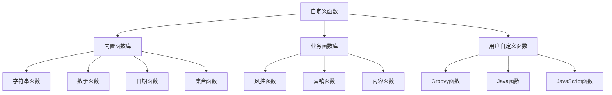

### 7.2 内置函数库

#### 7.2.1 字符串函数

| 函数名 | 参数 | 返回值 | 说明 |
|--------|------|--------|------|
| substring | (str, start, end) | String | 字符串截取 |
| contains | (str, substr) | Boolean | 是否包含子串 |
| matches | (str, regex) | Boolean | 正则匹配 |
| split | (str, delimiter) | List | 字符串分割 |
| concat | (str1, str2, ...) | String | 字符串拼接 |

#### 7.2.2 数学函数

| 函数名 | 参数 | 返回值 | 说明 |
|--------|------|--------|------|
| abs | (number) | Number | 绝对值 |
| max | (num1, num2, ...) | Number | 最大值 |
| min | (num1, num2, ...) | Number | 最小值 |
| round | (number, digits) | Number | 四舍五入 |
| random | (min, max) | Number | 随机数 |

#### 7.2.3 日期函数

| 函数名 | 参数 | 返回值 | 说明 |
|--------|------|--------|------|
| now | () | Date | 当前时间 |
| dateDiff | (date1, date2, unit) | Long | 时间差 |
| dateAdd | (date, amount, unit) | Date | 时间加减 |
| dateFormat | (date, pattern) | String | 日期格式化 |
| isWeekend | (date) | Boolean | 是否周末 |
| isHoliday | (date) | Boolean | 是否节假日 |

#### 7.2.4 集合函数

| 函数名 | 参数 | 返回值 | 说明 |
|--------|------|--------|------|
| size | (collection) | Integer | 集合大小 |
| contains | (collection, element) | Boolean | 是否包含元素 |
| distinct | (collection) | List | 去重 |
| filter | (collection, predicate) | List | 过滤 |
| map | (collection, function) | List | 映射转换 |

### 7.3 业务函数库

#### 7.3.1 风控函数

| 函数名 | 说明 | 输入 | 输出 |
|--------|------|------|------|
| calculateRiskScore | 计算综合风险分 | 因子列表、权重模型 | 风险分值 |
| isBlacklist | 判断是否在黑名单 | 实体ID、名单类型 | 布尔值 |
| deviceReputation | 获取设备信誉分 | 设备ID | 信誉分 |
| ipLocation | 获取IP归属地 | IP地址 | 城市信息 |
| velocityCheck | 速度检测 | 用户ID、事件、窗口 | 是否异常 |

#### 7.3.2 营销函数

| 函数名 | 说明 | 输入 | 输出 |
|--------|------|------|------|
| userSegment | 用户分群 | 用户ID | 分群标签 |
| couponEligible | 券资格校验 | 用户ID、券ID | 是否有资格 |
| recommendProducts | 商品推荐 | 用户ID、场景 | 推荐列表 |

### 7.4 自定义函数实现

#### 7.4.1 函数注册机制

**FunctionRegistry** - 函数注册中心

| 功能 | 说明 |
|------|------|
| 函数注册 | 注册自定义函数到引擎 |
| 函数查找 | 根据函数名查找实现 |
| 函数卸载 | 移除已注册的函数 |
| 命名空间 | 支持函数命名空间隔离 |

**注册方式**：

| 方式 | 说明 | 适用场景 |
|------|------|---------|
| 注解注册 | 通过@Function注解标记 | Java静态函数 |
| API注册 | 调用API动态注册 | 运行时动态函数 |
| 配置注册 | 通过配置文件声明 | 脚本函数 |
| SPI注册 | Java SPI机制 | 插件化函数 |

#### 7.4.2 函数定义规范

**CustomFunction** - 自定义函数接口

| 方法 | 说明 |
|------|------|
| getName | 函数名称 |
| getNamespace | 命名空间 |
| getParameterTypes | 参数类型列表 |
| getReturnType | 返回值类型 |
| execute | 执行函数逻辑 |
| validate | 参数验证 |

**函数元信息**：

| 元信息 | 说明 |
|--------|------|
| 函数名 | 全局唯一标识 |
| 参数列表 | 参数名称和类型 |
| 返回类型 | 返回值数据类型 |
| 函数描述 | 功能说明 |
| 示例 | 使用示例 |
| 版本 | 函数版本号 |

### 7.5 函数执行优化

#### 7.5.1 函数缓存

**缓存策略**：

| 缓存类型 | 说明 | 适用场景 |
|---------|------|---------|
| 结果缓存 | 缓存函数执行结果 | 纯函数、幂等函数 |
| 部分求值 | 缓存部分参数的结果 | 参数部分固定 |
| 惰性求值 | 延迟计算直到需要 | 结果可能不被使用 |

#### 7.5.2 函数编排

**函数组合**：

```
函数链式调用：
  结果 = filter(map(list, 转换函数), 过滤条件)

函数柯里化：
  部分函数 = curry(原函数, 固定参数)
  结果 = 部分函数(可变参数)

函数管道：
  结果 = list |> map(转换) |> filter(条件) |> reduce(聚合)
```

## 8. 规则调度体系

### 8.1 调度模式总览

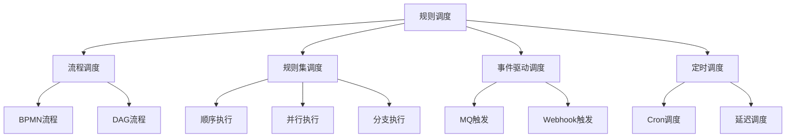

### 8.2 流程引擎调度

#### 8.2.1 DAG流程引擎

**设计思路**：基于有向无环图的规则编排

**流程节点类型**：

| 节点类型 | 说明 | 配置项 |
|---------|------|--------|
| 规则节点 | 执行单个规则 | 规则ID、超时时间 |
| 决策节点 | 条件分支判断 | 条件表达式、分支列表 |
| 并行节点 | 并行执行多个规则 | 子节点列表、聚合策略 |
| 子流程节点 | 嵌套子流程 | 子流程ID、参数映射 |
| 脚本节点 | 执行脚本逻辑 | 脚本内容、脚本语言 |
| 服务节点 | 调用外部服务 | 服务地址、请求参数 |

**流程示例 - 信贷审批**：

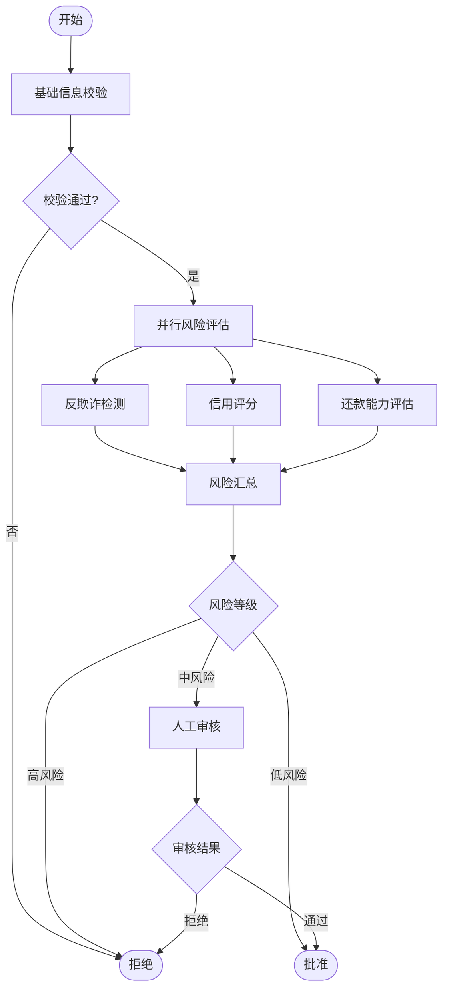

**DAG执行引擎**：

| 功能 | 说明 |
|------|------|
| 拓扑排序 | 确定节点执行顺序 |
| 依赖检查 | 检测并防止循环依赖 |
| 并行调度 | 无依赖节点并行执行 |
| 状态管理 | 追踪每个节点的执行状态 |
| 失败处理 | 支持重试、回滚、补偿 |

#### 8.2.2 BPMN流程引擎

**基于BPMN 2.0标准**：

**支持的BPMN元素**：

| 元素类型 | BPMN符号 | 用途 |
|---------|---------|------|
| 开始事件 | 空心圆 | 流程入口 |
| 结束事件 | 加粗圆 | 流程出口 |
| 任务 | 矩形 | 执行规则 |
| 排他网关 | 菱形X | 条件分支 |
| 并行网关 | 菱形+ | 并行执行 |
| 包容网关 | 菱形O | 多条件分支 |

**流程引擎选型**：
- Activiti
- Camunda
- Flowable

**集成方式**：

```
规则任务扩展：
  - 继承ServiceTask
  - 实现规则调用逻辑
  - 配置规则ID和参数映射
  - 处理规则执行结果
```

### 8.3 规则集调度

#### 8.3.1 顺序执行模式

**执行特点**：
- 规则按优先级依次执行
- 前一规则的输出可作为后续规则的输入
- 支持短路终止

**适用场景**：
- 规则间有依赖关系
- 需要保证执行顺序
- 决策链式推理

**执行策略**：

| 策略 | 说明 |
|------|------|
| 全部执行 | 执行所有规则，忽略中间失败 |
| 遇错停止 | 遇到失败规则立即停止 |
| 遇真停止 | 遇到条件满足的规则停止 |
| 优先级队列 | 动态调整执行顺序 |

#### 8.3.2 并行执行模式

**执行特点**：
- 多个规则同时执行
- 各规则独立无依赖
- 提升整体吞吐量

**并行策略**：

| 策略 | 说明 | 适用场景 |
|------|------|---------|
| 全并行 | 所有规则并行执行 | 规则完全独立 |
| 分组并行 | 按优先级分组，组内并行 | 部分规则有依赖 |
| 动态并行度 | 根据负载动态调整 | 资源受限环境 |

**结果聚合**：

| 聚合方式 | 说明 |
|---------|------|
| ALL | 等待所有规则完成 |
| ANY | 任意一个完成即返回 |
| MAJORITY | 多数完成即返回 |
| TIMEOUT | 超时后返回已完成的 |

#### 8.3.3 分支执行模式

**分支类型**：

| 分支模式 | 说明 | 决策依据 |
|---------|------|---------|
| 排他分支 | 仅执行一个分支 | 条件互斥 |
| 包容分支 | 执行满足条件的分支 | 条件可重叠 |
| 多路分支 | 根据值路由到不同分支 | 枚举值 |

**分支选择算法**：

```
IF-ELIF-ELSE模式：
  IF 条件1 THEN 执行规则集A
  ELIF 条件2 THEN 执行规则集B
  ELSE 执行规则集C

SWITCH模式：
  SWITCH (变量)
    CASE 值1: 执行规则集A
    CASE 值2: 执行规则集B
    DEFAULT: 执行规则集C
```

### 8.4 事件驱动调度

#### 8.4.1 事件模型

**事件类型**：

| 事件类型 | 触发方式 | 应用场景 |
|---------|---------|---------|
| 同步事件 | 业务直接调用 | 实时风控决策 |
| 异步事件 | MQ消息触发 | 异步风险处理 |
| 定时事件 | 定时任务触发 | 批量规则执行 |
| 流事件 | 实时数据流 | 流式计算场景 |

#### 8.4.2 事件订阅机制

**事件订阅配置**：

```
规则订阅配置：
  规则ID: login-risk-detection
  订阅事件: user.login
  过滤条件: event.channel == 'mobile'
  执行模式: ASYNC
  优先级: HIGH
```

**事件路由**：

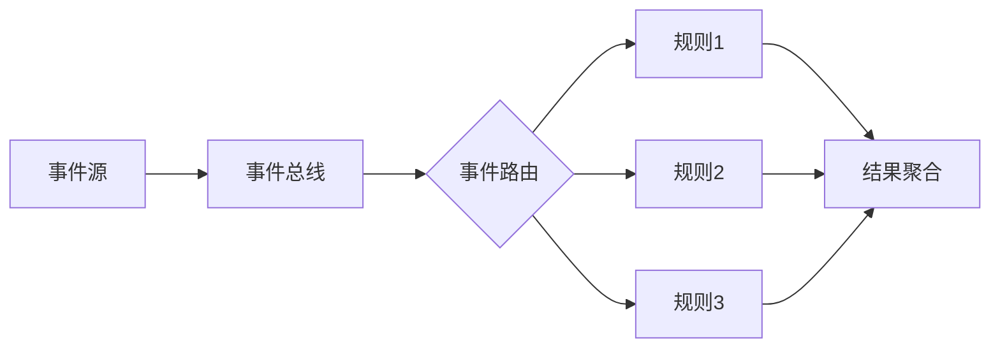

### 8.5 直接调用模式

#### 8.5.1 API直接调用

**同步调用**：

```
请求模式：
  POST /api/rule/execute
  
请求体：
  {
    "ruleId": "规则ID",
    "context": {
      "参数1": "值1",
      "参数2": "值2"
    }
  }
  
响应体：
  {
    "success": true,
    "decision": "PASS",
    "outputs": {...}
  }
```

**异步调用**：

```
请求模式：
  POST /api/rule/execute/async
  
响应：
  {
    "jobId": "执行任务ID"
  }
  
查询结果：
  GET /api/rule/job/{jobId}
```

#### 8.5.2 SDK调用

**调用示例**：

```
伪代码：
  // 创建执行器
  executor = RuleExecutorBuilder.create()
    .withEngine(EngineType.RETE)
    .withTimeout(1000)
    .build()
  
  // 构建上下文
  context = RuleContext.builder()
    .set("userId", "123456")
    .set("amount", 1000.0)
    .build()
  
  // 执行规则
  result = executor.execute("rule-001", context)
  
  // 获取决策
  decision = result.getDecision()
```

### 8.6 混合调度策略

**组合模式**：

| 场景 | 调度组合 | 说明 |
|------|---------|------|
| 实时+批量 | API调用 + 定时调度 | 实时决策+离线分析 |
| 同步+异步 | 同步快速规则 + 异步复杂规则 | 快速响应+深度分析 |
| 流程+规则集 | BPMN流程 + 并行规则集 | 业务流程+决策逻辑 |

## 9. 数据架构

### 9.1 规则元数据存储

**存储模型**：

| 实体 | 存储介质 | 说明 |
|------|---------|------|
| 规则定义 | MySQL/Etcd | 规则配置信息 |
| 规则版本 | MySQL | 版本历史记录 |
| 规则编译产物 | Redis | 编译后的规则对象 |
| 执行日志 | ES/ClickHouse | 规则执行明细 |

### 9.2 因子数据架构

**数据分层**：

| 层级 | 数据类型 | 存储 | 时效性 |
|------|---------|------|--------|
| 实时层 | 时间窗因子 | Redis/内存 | 秒级 |
| 准实时层 | 个体因子 | Redis | 分钟级 |
| 离线层 | 全局因子 | HBase/MySQL | 小时/天级 |

### 9.3 缓存策略

**多级缓存**：

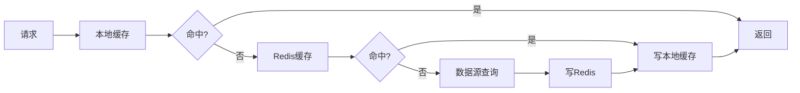

## 10. 监控与治理

### 10.1 性能监控

**监控指标**：

| 指标类别 | 指标项 | 告警阈值 |
|---------|--------|---------|
| 延迟指标 | P99执行时长 | &gt; 100ms |
| 吞吐指标 | QPS | &lt; 5000 |
| 成功率 | 执行成功率 | &lt; 99.9% |
| 资源指标 | CPU使用率 | &gt; 80% |

### 10.2 规则治理

**治理功能**：

| 功能 | 说明 |
|------|------|
| 规则版本管理 | 规则变更历史、回滚 |
| 规则影响分析 | 规则修改影响评估 |
| 规则冲突检测 | 检测规则间的逻辑冲突 |
| 规则效果评估 | 规则执行效果统计 |
| 规则生命周期 | 草稿→测试→生效→下线 |

### 10.3 AB测试

**AB测试能力**：

```
实验配置：
  实验名称: 新风控规则AB测试
  分流策略: 按用户ID hash分流
  对照组: 使用旧规则(50%)
  实验组: 使用新规则(50%)
  观察指标: 拦截率、误伤率
  实验周期: 7天
```

## 11. 技术实现路线

### 11.1 分阶段实现

**Phase 1 - 核心重构（2个月）**
- 规则定义抽象化
- 因子计算框架
- 轻量级引擎优化

**Phase 2 - 引擎增强（2个月）**
- RETE引擎集成
- 脚本引擎实现
- 性能Benchmark

**Phase 3 - 插件体系（1.5个月）**
- 插件框架搭建
- 自定义函数体系
- 插件市场

**Phase 4 - 调度体系（1.5个月）**
- DAG流程引擎
- BPMN集成
- 事件驱动调度

**Phase 5 - 治理平台（1个月）**
- 监控大盘
- AB测试
- 规则治理工具

### 11.2 技术风险

| 风险项 | 影响 | 应对措施 |
|--------|------|---------|
| RETE引擎性能 | 高规则量下性能问题 | 分片执行、规则优化 |
| 插件隔离 | 插件异常影响主流程 | 沙箱隔离、熔断降级 |
| 因子计算延迟 | 影响整体响应时间 | 缓存预热、异步计算 |
| 规则冲突 | 规则逻辑矛盾 | 冲突检测工具 |

### 11.3 兼容性策略

**向后兼容**：
- 保留现有RuleDefinition接口
- 提供适配器转换为新协议
- 分阶段迁移业务

**平滑升级**：
- 双引擎并行运行
- 灰度切换流量
- 回滚机制
