# Themis Rule Engine Design Document

## Overview

Themis is a highly abstracted, production-ready rule engine system designed for enterprise-level applications. The system provides comprehensive rule management capabilities with pluggable architecture, supporting multiple rule types, execution engines, and metadata persistence strategies.

### Core Features
- **Multi-type Rule Support**: Expression rules, branching rules, formula calculations, rule tables, and scorecards
- **Flexible Rule Definition**: Java Fluent API and DSL metadata-based definitions
- **Pluggable Architecture**: Decoupled rule execution from metadata management
- **Multiple Execution Engines**: Default engine and RETE algorithm-based engine
- **Extensible Persistence**: Database, Etcd, Redis, and custom storage backends
- **Rule Orchestration**: Workflow engine integration for complex rule compositions
- **AI-Powered Translation**: Bidirectional conversion between rule syntax and natural language

### Technology Stack
- **Language**: Java 8
- **Framework**: Spring Boot
- **ORM**: MyBatis
- **Build Tool**: Maven
- **Rule Engine Core**: Custom implementation + Drools integration

## Architecture

### System Architecture Overview

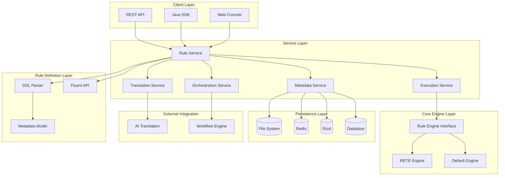

### Core Module Architecture

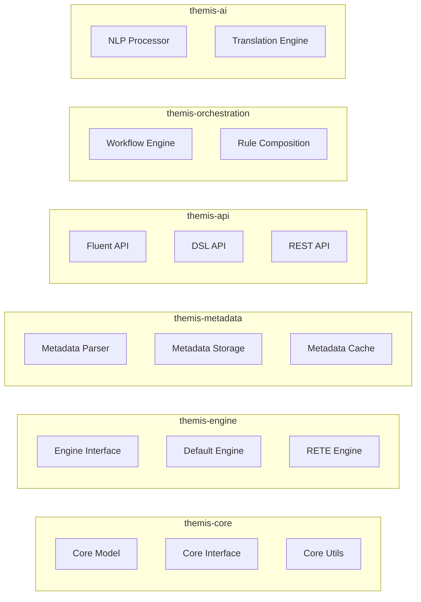

## Data Models & Core Entities

### Rule Metadata Model

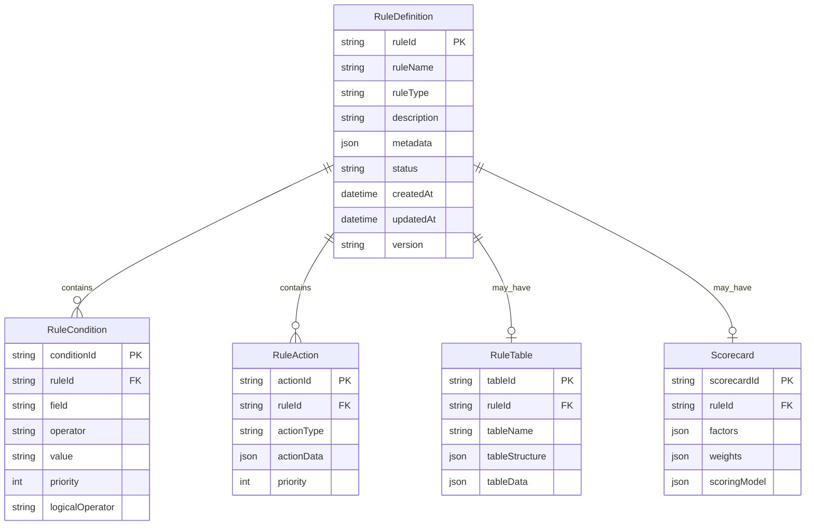

### Rule Types Hierarchy

| Rule Type | Description | Example Use Case |
|-----------|-------------|------------------|
| **Expression Rule** | Simple condition-action rules | `if age > 18 then eligible = true` |
| **Branching Rule** | Multi-condition decision trees | Credit approval workflows |
| **Formula Rule** | Mathematical calculations | `score = weight1 * factor1 + weight2 * factor2` |
| **Rule Table** | Decision tables with multiple dimensions | Tax rate calculation based on income and region |
| **Scorecard** | Multi-factor scoring models | Credit score calculation |
| **Composite Rule** | Combination of multiple rule types | Complex business processes |

## Rule Definition APIs

### Fluent API Design

```java
// Expression Rule
Rule expressionRule = RuleBuilder.create("eligibility-check")
    .when(condition -> condition
        .field("age").greaterThan(18)
        .and()
        .field("income").greaterThan(50000))
    .then(action -> action
        .set("eligible", true)
        .set("message", "Approved"))
    .build();

// Branching Rule
Rule branchingRule = RuleBuilder.create("credit-decision")
    .when("score").greaterThan(750)
        .then(action -> action.set("decision", "APPROVED"))
    .when("score").between(600, 750)
        .then(action -> action.set("decision", "MANUAL_REVIEW"))
    .otherwise()
        .then(action -> action.set("decision", "REJECTED"))
    .build();

// Formula Rule
Rule formulaRule = RuleBuilder.create("risk-score")
    .formula("riskScore = creditScore * 0.4 + incomeRatio * 0.3 + debtRatio * 0.3")
    .build();

// Scorecard Rule
Rule scorecardRule = RuleBuilder.create("credit-scorecard")
    .scorecard(scorecard -> scorecard
        .factor("creditHistory", 0.35)
        .factor("income", 0.25)
        .factor("debtRatio", 0.20)
        .factor("employment", 0.20))
    .build();
```

### DSL Metadata Format

```json
{
  "ruleId": "credit-approval-001",
  "ruleName": "Credit Approval Rule",
  "ruleType": "BRANCHING",
  "version": "1.0.0",
  "metadata": {
    "conditions": [
      {
        "field": "creditScore",
        "operator": ">=",
        "value": 700,
        "weight": 0.4
      },
      {
        "field": "income",
        "operator": ">=",
        "value": 50000,
        "weight": 0.3
      }
    ],
    "actions": [
      {
        "type": "SET_FIELD",
        "field": "approved",
        "value": true
      },
      {
        "type": "SET_FIELD",
        "field": "creditLimit",
        "value": "${income * 3}"
      }
    ]
  }
}
```

## Rule Engine Interface & Implementations

### Core Engine Interface

```java
public interface RuleEngine {
    RuleExecutionResult execute(RuleContext context, RuleDefinition rule);
    BatchExecutionResult executeBatch(RuleContext context, List<RuleDefinition> rules);
    ValidationResult validate(RuleDefinition rule);
    EngineCapabilities getCapabilities();
}

public interface RuleContext {
    Object getAttribute(String key);
    void setAttribute(String key, Object value);
    Map<String, Object> getAllAttributes();
    RuleExecutionMode getExecutionMode();
}
```

### Default Rule Engine Implementation

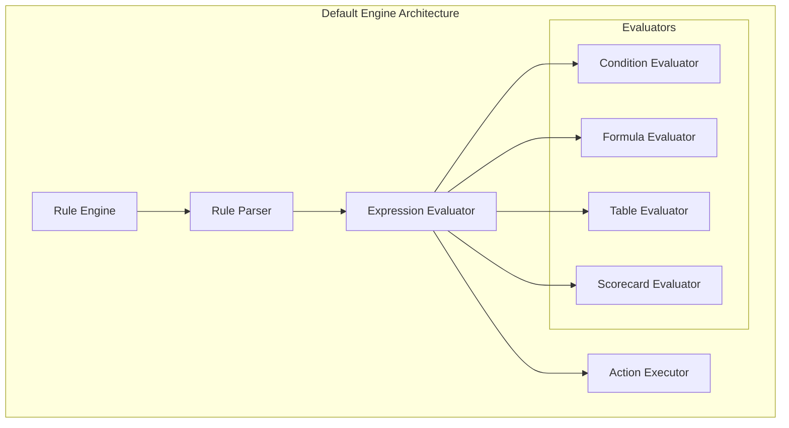

### RETE Algorithm Engine Implementation

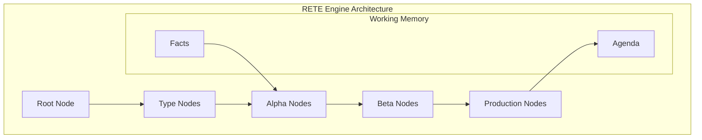

## Metadata Persistence Layer

### Storage Abstraction

```java
public interface MetadataStorage {
    void save(RuleDefinition rule);
    RuleDefinition load(String ruleId);
    List<RuleDefinition> loadByType(RuleType type);
    void delete(String ruleId);
    List<RuleDefinition> search(MetadataQuery query);
}
```

### Storage Implementation Matrix

| Storage Type | Use Case | Consistency | Performance | Scalability |
|-------------|----------|-------------|-------------|-------------|
| **Database** | Persistent storage, ACID transactions | Strong | Medium | High |
| **Etcd** | Distributed configuration, watch capabilities | Strong | High | High |
| **Redis** | Cache layer, session storage | Eventual | Very High | Medium |
| **File System** | Development, simple deployments | Strong | Low | Low |

### Metadata Cache Strategy

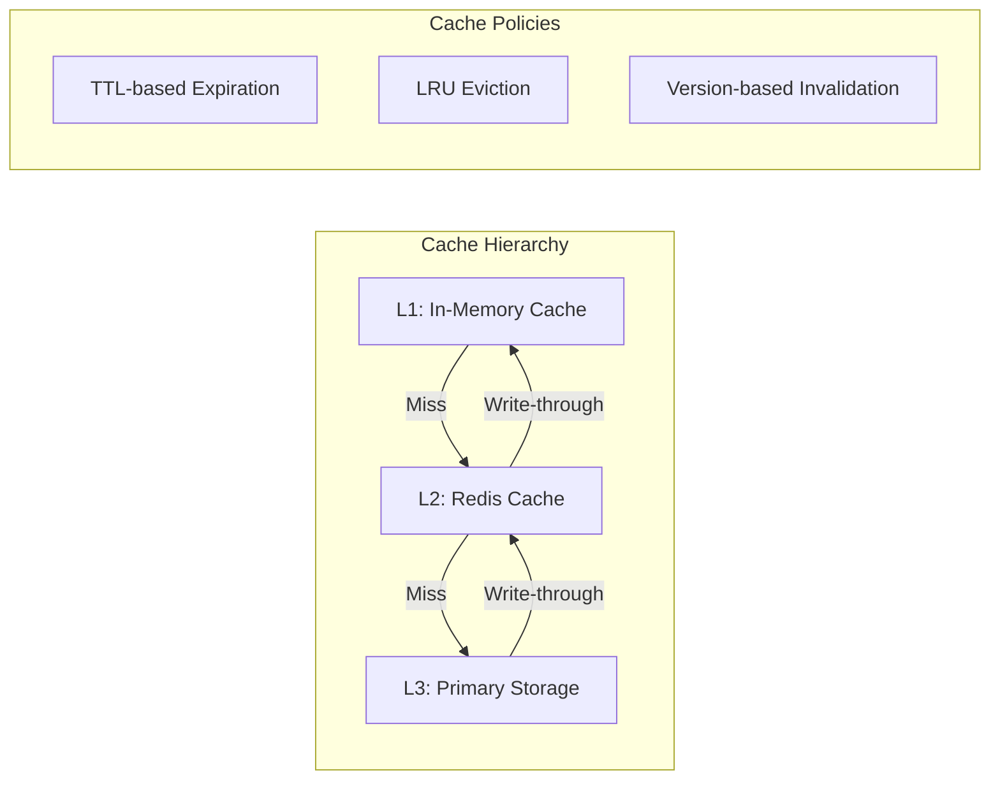

## Rule Orchestration & Workflow Integration

### Workflow Engine Integration

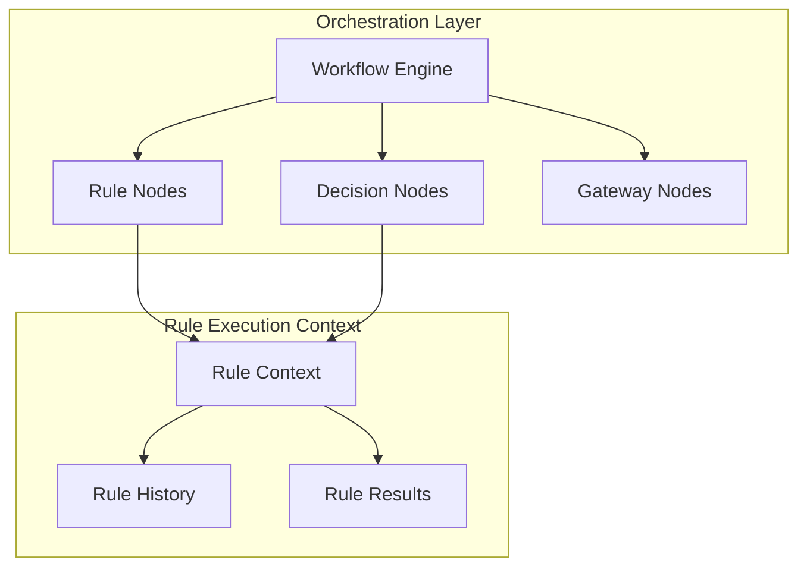

### Rule Composition Patterns

| Pattern | Description | Use Case |
|---------|-------------|----------|
| **Sequential** | Rules execute in order | Step-by-step validation |
| **Parallel** | Rules execute simultaneously | Independent calculations |
| **Conditional** | Rules execute based on conditions | Branching logic |
| **Loop** | Rules execute iteratively | Iterative refinement |
| **Fork-Join** | Parallel execution with synchronization | Complex decision trees |

## AI-Powered Rule Translation

### Natural Language Processing Pipeline

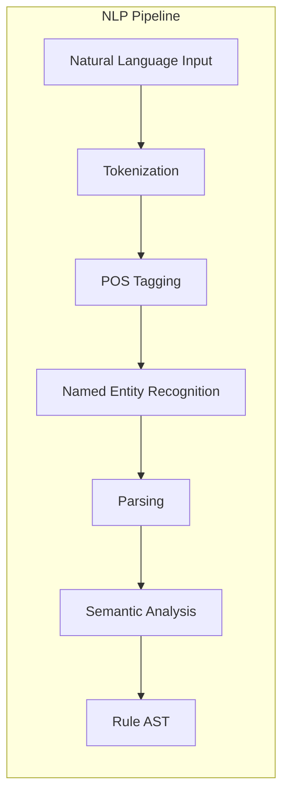

### Translation Examples

| Natural Language | Rule DSL |
|------------------|----------|
| "If customer age is greater than 18, approve the application" | `{"field": "age", "operator": ">", "value": 18, "action": "approve"}` |
| "Calculate risk score as 40% credit score plus 30% income ratio" | `{"formula": "riskScore = creditScore * 0.4 + incomeRatio * 0.3"}` |
| "High-income customers with good credit get premium rates" | `{"conditions": [{"field": "income", "operator": ">=", "value": "high"}, {"field": "creditRating", "operator": "==", "value": "good"}], "action": {"rate": "premium"}}` |

## API Endpoints Reference

### Rule Management APIs

| Endpoint | Method | Description |
|----------|--------|-------------|
| `/api/v1/rules` | GET | List all rules |
| `/api/v1/rules` | POST | Create new rule |
| `/api/v1/rules/{id}` | GET | Get rule by ID |
| `/api/v1/rules/{id}` | PUT | Update rule |
| `/api/v1/rules/{id}` | DELETE | Delete rule |
| `/api/v1/rules/{id}/execute` | POST | Execute specific rule |
| `/api/v1/rules/batch/execute` | POST | Execute multiple rules |

### Rule Execution APIs

| Endpoint | Method | Description |
|----------|--------|-------------|
| `/api/v1/execution/sync` | POST | Synchronous rule execution |
| `/api/v1/execution/async` | POST | Asynchronous rule execution |
| `/api/v1/execution/{jobId}/status` | GET | Get execution status |
| `/api/v1/execution/{jobId}/result` | GET | Get execution result |

### Translation APIs

| Endpoint | Method | Description |
|----------|--------|-------------|
| `/api/v1/translate/nl-to-rule` | POST | Natural language to rule |
| `/api/v1/translate/rule-to-nl` | POST | Rule to natural language |
| `/api/v1/translate/validate` | POST | Validate translation |

## Business Logic Layer Architecture

### Rule Service Layer

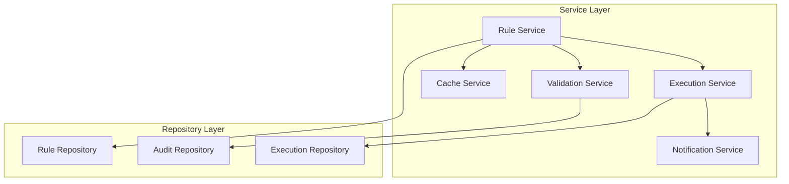

### Rule Validation Framework

```java
public interface RuleValidator {
    ValidationResult validate(RuleDefinition rule);
}

// Validation Chain
public class ValidationChain {
    private List<RuleValidator> validators;
    
    // Syntax validation
    // Semantic validation  
    // Performance validation
    // Security validation
}
```

## Middleware & Interceptors

### Rule Execution Pipeline

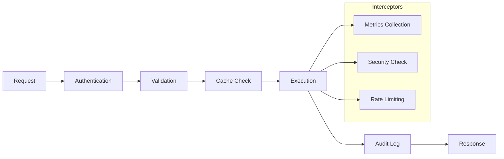

### Middleware Components

| Middleware | Purpose | Configuration |
|------------|---------|---------------|
| **Authentication** | User identity verification | JWT, OAuth2, API Key |
| **Authorization** | Permission checking | RBAC, Rule-based access |
| **Rate Limiting** | Request throttling | Redis-based counters |
| **Metrics Collection** | Performance monitoring | Micrometer, Prometheus |
| **Audit Logging** | Compliance tracking | Database, Elasticsearch |
| **Circuit Breaker** | Fault tolerance | Hystrix, Resilience4j |

## Testing Strategy

### Unit Testing Framework

```java
@ExtendWith(MockitoExtension.class)
class RuleEngineTest {
    
    @Mock
    private MetadataStorage metadataStorage;
    
    @InjectMocks
    private DefaultRuleEngine ruleEngine;
    
    @Test
    void testExpressionRuleExecution() {
        // Given
        RuleDefinition rule = createExpressionRule();
        RuleContext context = createContext();
        
        // When
        RuleExecutionResult result = ruleEngine.execute(context, rule);
        
        // Then
        assertThat(result.isSuccess()).isTrue();
        assertThat(result.getOutputs()).containsEntry("eligible", true);
    }
}
```

### Integration Testing Strategy

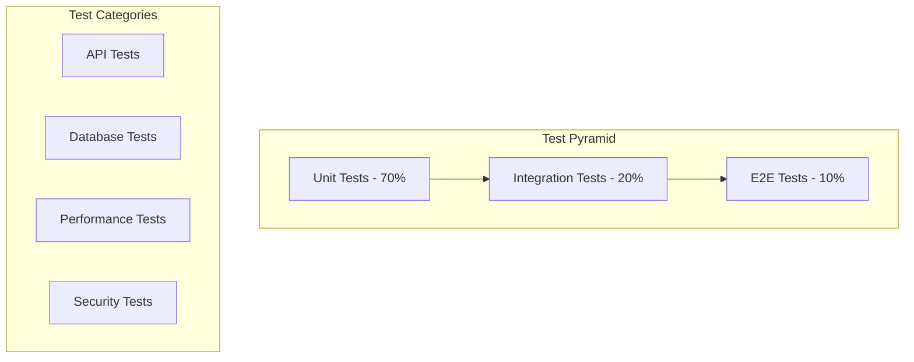

### Test Data Management

| Test Type | Data Strategy | Tools |
|-----------|---------------|-------|
| **Unit Tests** | Mock data, test fixtures | Mockito, Testcontainers |
| **Integration Tests** | Test databases, embedded services | H2, Embedded Redis |
| **Performance Tests** | Large datasets, load simulation | JMeter, Gatling |
| **Security Tests** | Vulnerability scanning | OWASP ZAP, SonarQube |