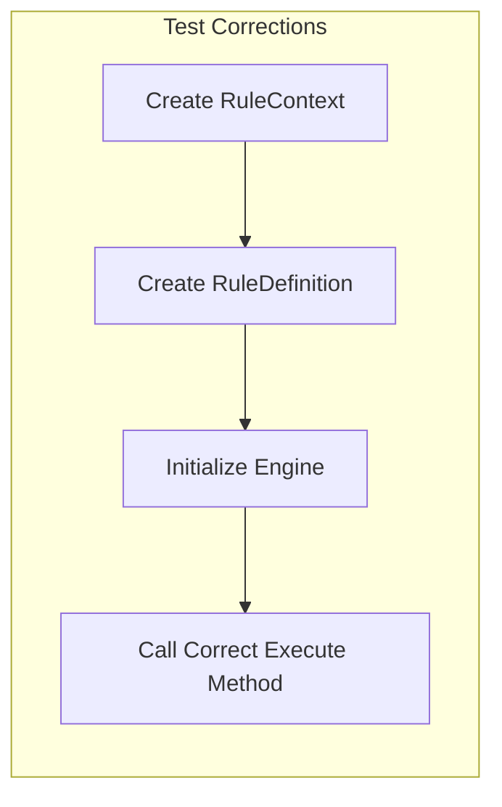
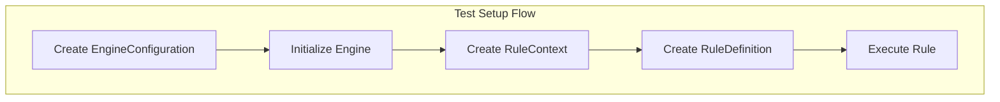
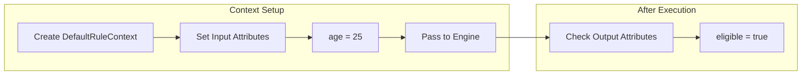
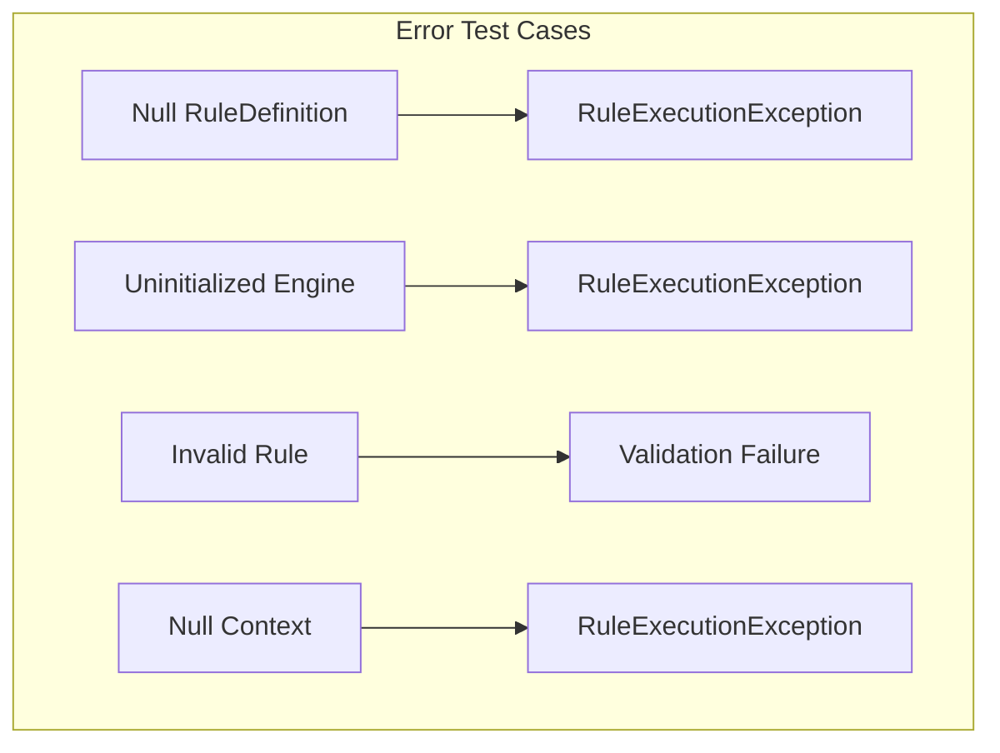

# Test Issue Resolution Design

## Overview

This design document addresses the critical issues identified in the `DefaultRuleEngineTest.java` test file that prevent proper test execution and validation of the rule engine functionality. The test file reveals several fundamental mismatches between the test expectations and the actual implementation of the DefaultRuleEngine.

## Architecture

### Current Test Architecture Issues

```mermaid
graph TD
    subgraph "Test Problems"
        T[DefaultRuleEngineTest]
        T -->|calls| WM[Wrong Method execute(String, Map)]
        T -->|expects| MS[MetadataStorage integration]
        T -->|missing| RC[RuleContext parameter]
        T -->|missing| EI[Engine initialization]
    end
    
    subgraph "Actual Engine Interface"
        RE[RuleEngine]
        RE -->|requires| RCX[RuleContext context]
        RE -->|requires| RD[RuleDefinition rule]
        RE -->|requires| INIT[initialize() call]
    end
    
    WM -.->|mismatch| RCX
    MS -.->|not integrated| RE
```

### Corrected Test Architecture

```mermaid
graph TD
    subgraph "Fixed Test Design"
        NT[Fixed Test]
        NT -->|uses| CRC[Correct RuleContext]
        NT -->|uses| CRD[Correct RuleDefinition]
        NT -->|calls| CI[Correct initialize()]
        NT -->|integrates| MS[MetadataStorage properly]
    end
    
    subgraph "Engine Dependencies"
        RE[DefaultRuleEngine]
        RC[RuleContext]
        RD[RuleDefinition]
        EC[EngineConfiguration]
        
        RE -->|needs| EC
        RE -->|executes with| RC
        RE -->|executes| RD
    end
    
    NT --> RE
```

## Test Issues Analysis

### Issue 1: Incorrect Method Signature
**Problem**: Test calls `execute(String ruleId, Map<String, Object> context)`
**Actual Interface**: `execute(RuleContext context, RuleDefinition rule)`

### Issue 2: Missing Engine Initialization
**Problem**: DefaultRuleEngine is not initialized before use
**Required**: Call `initialize(EngineConfiguration)` method

### Issue 3: MetadataStorage Integration Mismatch
**Problem**: Test assumes engine automatically loads rules from MetadataStorage
**Reality**: Engine requires RuleDefinition objects passed directly

### Issue 4: Missing Rule Context Creation
**Problem**: Test passes raw Map instead of RuleContext
**Required**: Create DefaultRuleContext with proper attributes

### Issue 5: Incomplete Rule Definition Setup
**Problem**: ExpressionRule missing required fields for validation
**Required**: Set all mandatory fields including RuleType, status, etc.

## Test Correction Strategy

### Strategy 1: Minimal Fix (Recommended)
Update test to match current engine interface without changing engine implementation.



### Strategy 2: Engine Adapter Pattern
Create convenience methods in engine to support the test's expected interface.

### Strategy 3: Test Helper Classes
Create test utilities to simplify rule creation and engine setup.

## Component Design

### Fixed Test Structure

| Component | Current Issue | Fix Required |
|-----------|---------------|--------------|
| Engine Initialization | Missing | Add `initialize()` call |
| Rule Creation | Incomplete | Set all required fields |
| Context Creation | Wrong type | Use `DefaultRuleContext` |
| Method Call | Wrong signature | Use `execute(context, rule)` |
| Storage Integration | Assumed automatic | Manual rule passing |

### Engine Configuration Setup



### Rule Definition Construction

| Field | Required | Test Value |
|-------|----------|------------|
| ruleId | Yes | "test-rule" |
| ruleName | Yes | "Test Rule" |
| ruleType | Yes | RuleType.EXPRESSION |
| status | Yes | RuleStatus.ACTIVE |
| condition | Yes | "age > 18" |
| actions | Yes | List of RuleAction |
| priority | Yes | Default value |
| version | Yes | "1.0" |

### Context Attribute Management



## Testing Strategy

### Unit Test Structure

1. **Setup Phase**
   - Initialize EngineConfiguration
   - Create and initialize DefaultRuleEngine
   - Prepare test data (rules, contexts)

2. **Execution Phase**
   - Create RuleContext with input data
   - Create properly configured RuleDefinition
   - Execute rule through engine

3. **Verification Phase**
   - Verify execution result success/failure
   - Check output attributes in context
   - Validate execution metadata

### Test Method Corrections

#### shouldExecuteExpressionRule Test
- Fix: Create proper RuleDefinition with all required fields
- Fix: Use RuleContext instead of raw Map
- Fix: Initialize engine before use
- Fix: Use correct execute method signature

#### shouldThrowExceptionForNonExistentRule Test
- Fix: Test engine behavior for null/invalid RuleDefinition
- Fix: Verify RuleExecutionException is thrown
- Fix: Update exception type expectations

### Error Handling Verification

